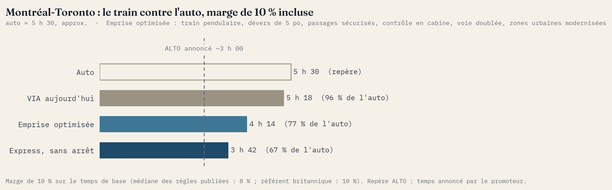
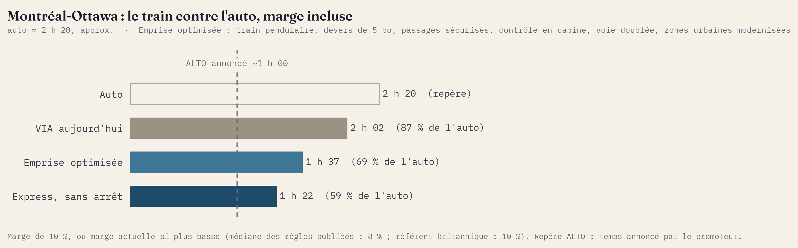
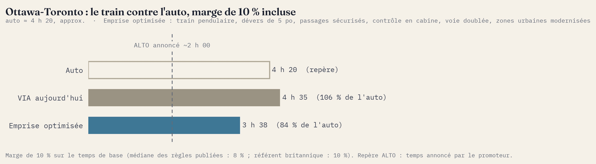

# L'essentiel

Le projet ALTO propose de construire environ 1 000 km de voies neuves pour relier Québec à Toronto à 300 km/h [@alto2025]. Cette étude répond à une question complémentaire : combien de temps le train prendrait-il sur l'emprise qui existe déjà, si on la modernisait?

Une fois l'emprise optimisée, le train Montréal-Toronto via Kingston passerait de 5 h 18 aujourd'hui à 4 h 14, soit 1 h 04 de moins (−20 %). Près d'une heure serait aussi retirée du trajet Montréal-Québec, qui passerait de 3 h 22 à 2 h 26 (−28 %). Le temps de parcours Montréal-Ottawa, lui, serait réduit de 23 minutes (−19 %).

Sans offrir une vitesse équivalente à la prévision d'ALTO, l'amélioration de l'emprise existante offre un train compétitif, pour une fraction de l'effort, du temps et du coût. Cet investissement aurait aussi l'avantage d'améliorer la sécurité des opérations des trains de marchandises et de réduire les nuisances pour les populations avoisinantes du chemin de fer, notamment par la sécurisation des croisements routiers. À titre de repère, le promoteur d'ALTO estime son projet de 60 à 90 G\$ CA, et le directeur parlementaire du budget de 75 à 113 G\$ CA [@dpb2026alto]. La construction du premier tronçon doit commencer vers 2029-2030, et chaque phase durerait de 7 à 10 ans [@altotrain2026faq].

**Temps de parcours.**

  | Trajet | Auto (repère) | Voie actuelle | Emprise optimisée | Express, sans arrêt | ALTO annoncé |
|---|---|---|---|---|---|
| [Montréal-Québec (270 km)]{.insecable} | ~2 h 50 | 3 h 22 | 2 h 26 | 2 h 08 | ~1 h 30 |
| [Montréal-Ottawa (185 km)]{.insecable} | ~2 h 20 | 2 h 02 | 1 h 39 | 1 h 24 | ~1 h |
| [Ottawa-Toronto (442 km)]{.insecable} | ~4 h 20 | 4 h 35 | 3 h 55 | 3 h 10 | ~2 h |
| [Montréal-Toronto (536 km)]{.insecable} | ~5 h 30 | 5 h 18 | 4 h 14 | 3 h 42 | 3 h |

La colonne de l'express donne le même train sans aucun arrêt intermédiaire (section 9). Le temps en auto est une estimation à partir de la cartographie routière grand public, approximative. Les temps du projet ALTO viennent du promoteur [@altotrain2026faq] ; le 3 h Montréal-Toronto est d'ailleurs un engagement du gouvernement [@pmcanada2025alto]. À notre connaissance, le promoteur ne précise pas si ces temps comprennent une marge d'exploitation ; les nôtres en comprennent 10 %. De bout en bout, Québec-Toronto via Montréal passerait de 8 h 50 aujourd'hui à 6 h 51, avec dix minutes d'arrêt à Montréal, ou à 6 h 00 en express, contre environ 4 h 30 pour le projet ALTO.

Aujourd'hui, le train fait à peu près jeu égal avec l'auto sur Montréal-Toronto et la perd nettement sur Montréal-Québec. Sur l'emprise optimisée, le train prend de 71 à 90 % du temps de l'auto selon le trajet : il devient plus rapide que l'auto partout.

**Les villes intermédiaires.** Ces temps comprennent un arrêt à chacune des 22 gares intermédiaires où s'arrêtent aujourd'hui les trains de VIA, de Saint-Hyacinthe et Drummondville à Cornwall et Kingston (la liste complète est à la section 2). L'emprise optimisée améliore donc aussi le service ferroviaire des régions desservies par ces gares, alors que le projet ALTO prévoit sept gares sur l'ensemble de son réseau [@altotrain2026faq]. Un train express qui ne s'arrêterait qu'aux grandes villes gagnerait encore de 15 à 45 minutes selon le trajet (section 9).

**Gain d'achalandage.** Cette optimisation pourrait permettre un gain d'achalandage très important, même si la vitesse n'est pas celle d'un TGV. Selon l'étude EcoTrain commandée par les gouvernements du Québec, de l'Ontario et du Canada, l'option à 200 km/h récupère 92 % de l'achalandage prévu pour l'option à 300 km/h, d'après les prévisions de son tableau 5-7 (10,2 contre 11,1 millions de voyageurs en 2031) [@ecotrain2011, p. 54]. Bien que la modernisation proposée ne soit pas identique à ce scénario, qui supposait une voie dédiée et 3 h 38 entre Montréal et Toronto [@ecotrain2011, p. 81], celui-ci permet d'illustrer que la haute vitesse semble générer des gains d'achalandage fortement décroissants au-delà de la compétitivité avec l'auto.

**Les actions pour réduire le temps de trajet.** La réduction du temps de parcours est réalisable grâce aux cinq actions suivantes.

1. **Doublement des voies.** La voie est simple sur 37 % du corridor. Un doublement permettrait une cohabitation où le passager et le fret gagnent tous les deux, au lieu de se voler des minutes.
2. **Une signalisation modernisée.** Grâce à l'installation d'un système de contrôle de train en cabine comme celui déjà utilisé aux États-Unis, la distance nécessaire entre les trains sera de beaucoup réduite, ce qui favorisera la cohabitation et permettra de donner la priorité aux trains de passagers, dont dépend leur ponctualité. Ce système permet de dépasser la limite actuelle de 153 km/h. Nous retenons 177 km/h (110 mi/h) tant que des passages à niveau demeurent.
3. **Arbitrage de l'Office des transports du Canada.** Nous proposons de renforcer l'arbitrage que la loi prévoit déjà pour VIA : rendre permanent le pouvoir de l'Office de régler la priorité des trains, lui donner une orientation claire en faveur du service aux passagers, et lui imposer des délais, avec des normes de ponctualité et des pénalités [@ltc1996art152; @lc2007ch19art55].
4. **Passages à niveau sécurisés.** Le corridor en compte 924. Il faudra en sécuriser 533 qui n'ont pas de barrières complètes. Un programme complémentaire et optionnel, présenté à part, éliminerait le tiers des croisements par des ponts d'étagement pour améliorer davantage la sécurité. S'il vise d'abord les passages où le train pourrait rouler plus vite, il rachète aussi jusqu'à 8 minutes sur Montréal-Toronto.
5. **Train pendulaire et voies plus inclinées dans les courbes.** Un train pendulaire incline sa caisse dans les courbes. De plus, on incline la voie au maximum standard du CN (dévers de 127 mm, soit 5 po) dans les courbes. Cela permet de faire en sorte que les passagers ne sentent pas la courbe et donc, que le train puisse la franchir plus vite. Comme le corridor n'est pas électrifié, ce train serait diesel, et il faudrait le commander sur mesure (section 7). La configuration retenue correspond à un train ayant déjà été en opération, la Class 221 britannique, non à un idéal théorique.

Les actions 1 à 3 réduisent la marge d'exploitation, soit l'écart entre le temps de parcours réel et la possibilité théorique fondée sur la géométrie de la voie. Les actions 4 et 5 accroissent cette possibilité théorique : le train pendulaire prend les courbes plus vite, et les passages sécurisés, avec le contrôle en cabine, autorisent 177 km/h. L'analyse des données et les conseils de notre expert ferroviaire [@dusablon2026] nous permettent de retenir une marge d'exploitation de 10 %, alignée sur la West Coast Main Line britannique, qui relie Londres à Manchester et Glasgow avec des trains pendulaires à 201 km/h sur des voies partagées avec les trains de marchandises. Nous estimons le coût de ces cinq actions à environ 9 G\$ CA de 2025 (section 11). Techniquement, elles n'exigent de retirer aucun passage à niveau : des barrières complètes suffisent. Pour des raisons d'acceptabilité, de cohabitation avec les riverains et de modernisation du corridor, nous avons aussi chiffré un programme complémentaire d'élimination du tiers des croisements par des ponts d'étagement, pour environ 8,2 G\$ CA. Avec 20 % pour les imprévus, les deux volets représentent ensemble environ 21 G\$ CA. Un second programme optionnel et indépendant, l'électrification du corridor, est examiné à la section 10.

![Facteurs de réduction des temps de parcours, trajet par trajet. La barre pleine, incluant les parties colorées, est l'horaire actuel. Le segment sans couleur est le temps du train express. Cinq facteurs se partagent le gain : le trajet express, sans arrêt intermédiaire ; la cohabitation, qui réunit le régime de circulation avec le fret et le doublement des voies ; le train pendulaire et les zones urbaines, comptés sous la classe de voie actuelle (153 km/h, 95 mi/h) ; et le changement de classe, soit ce que ces facteurs rapportent en plus une fois le plafond porté à 177 km/h grâce aux passages à niveau sécurisés et à la signalisation.](livrables/figure_gains.png)

La table qui suit montre l'impact des actions. Ses postes se lisent sur le trajet complet Québec-Toronto, jusqu'au train express ; la section 12 donne le détail en minutes.

  | Facteur de réduction du temps de parcours | Part du gain, train express |
|---|---|
| Cohabitation : doublement des voies, arbitrage, capacité libérée par la signalisation | 33 % |
| Changement de classe de vitesse : passages à niveau sécurisés et contrôle en cabine | 14 % |
| Train pendulaire et dévers | 18 % |
| Zones urbaines modernisées | 5 % |
| **Trajet express : ~51 min** | **30 %** |

# Comment nous avons mesuré {.suite}

## La méthode

Pour réaliser ce rapport, nous avons combiné l'expertise d'un expert ferroviaire avec une analyse assistée par agents de codage (IA) des données publiques disponibles, provenant notamment des images satellites. Cette analyse a été réalisée par Vincent Duguay, étudiant à la maîtrise recherche à l'ENAP.

Notre expert ferroviaire, Pierre DuSablon, a une longue expérience dans le domaine ferroviaire et a notamment été responsable des opérations du CN sur la section Montréal-Québec. Il a utilisé les diagrammes de la voie entre Québec et Montréal pour évaluer l'impact de certaines actions visant à réduire les temps de parcours. Son avis, reproduit intégralement en annexe, vient valider les hypothèses de l'analyse de Vincent Duguay [@dusablon2026].

**Analyse assistée par agents de codage (IA) des données satellites.** Comme VIA Rail ne fournit pas une géométrie suffisamment détaillée de sa voie, la géométrie du tracé vient des données ouvertes OpenStreetMap, appariées aux horaires de VIA. Ces deux sources publiques se complètent. Les horaires ouverts de VIA (le format GTFS, celui des applications de transport) disent quelles lignes le train emprunte et à quelle heure [@viarail2026gtfs]. La carte collaborative OpenStreetMap dit où les rails passent physiquement, à quelques mètres près [@osm2026geofabrik]. L'étude accroche le tracé de VIA sur la voie réelle d'OpenStreetMap et suit cette voie comme un train le ferait. Les passages à niveau viennent de l'inventaire officiel de Transports Canada [@tc2023inventairepn]. Le nombre de voies, lui, est détecté par la géométrie des voies parallèles dans la carte. La page de crédits décrit la méthode de travail avec les agents de codage.

**Les ouvrages d'art des sections à doubler.** Doubler la voie demande aussi de doubler les ponts ferroviaires des sections à voie simple. Aucun inventaire officiel des ponts ferroviaires n'est public : ceux du CN, de VIA et des autres propriétaires ne sont pas publiés. Nous avons donc dressé notre propre inventaire en croisant deux sources indépendantes : les ponts étiquetés dans OpenStreetMap [@osm2026ponts] et les structures du Réseau ferroviaire national de Ressources naturelles Canada, figé en 2014 au Québec et en 2016 en Ontario [@rncan2016rfn]. Là où les deux sources divergeaient, l'imagerie satellite a tranché. L'inventaire compte 245 ponts sur les deux corridors, ponceaux exclus. Entre Québec et Montréal, il concorde avec le décompte de notre expert ferroviaire : 72 ouvrages, contre 71 dans son avis [@dusablon2026]. Sur les sections à voie simple, 79 ouvrages seraient à doubler. Nous en retirons le pont de Québec, qui ne porte qu'une voie : le doubler demanderait un nouveau franchissement, un projet en soi. Il reste 78 ouvrages, pour un peu plus de 4 km de tablier. La section 11 détaille ce décompte et en tire le coût des ouvrages d'art.

## Le modèle de temps, étape par étape

Un temps de parcours se construit en six étapes. Le tableau qui suit les déroule dans l'ordre, sur un même trajet : Montréal-Toronto. Chaque étape part du résultat de la précédente et y ajoute ce qu'elle coûte. Les quatre trajets suivent exactement le même calcul.

::: {.chronologie}

| Étape | Ce que fait le modèle | Ajoute | Temps cumulé |
|---|---------------------------------------------|-----|-----|
| 1 | **Mesurer la voie.** Le tracé vient d'OpenStreetMap, accroché aux horaires de VIA. Nous en tirons le rayon de chaque courbe, et la pente à partir d'un modèle de relief [@openmeteo2026altitude]. Sur les segments courbes de moins de 900 m, le rayon est divisé par deux, par prudence (voir plus bas). | | 536 km |
| 2 | **Limiter la vitesse dans chaque courbe.** Une courbe de rayon R limite la vitesse selon la formule `v = k·√R`. Le coefficient k dépend de l'inclinaison de la voie et de la tolérance du train : il vaut 4,82 pour le train pendulaire sur une voie au dévers maximal du CN (section 7). Avec l'écartement effectif utilisé, cette formule reproduit exactement la méthode officielle du CN [@cn2002mr1305]. Les approches de Montréal, Québec, Ottawa et Toronto suivent le même calcul : leurs courbes serrées y limitent déjà la vitesse. | 2 h 14 | 2 h 14 |
| 3 | **Plafonner à 177 km/h.** En chaque point, le train roule à la plus basse de deux vitesses : celle que la courbe permet, et le plafond de 177 km/h (110 mi/h) retenu à la section 6. À ce stade, le train changerait encore de vitesse instantanément. | +55 min | 3 h 09 |
| 4 | **S'arrêter aux gares.** Montréal-Toronto compte huit gares intermédiaires. À chacune, le train reste immobile deux minutes, la médiane des horaires de VIA [@viarail2026gtfs]. Le freinage et la relance de ces arrêts sont comptés à l'étape suivante. | +16 min | 3 h 25 |
| 5 | **Faire accélérer et freiner un vrai train.** Le train ralentit maintenant pour de vrai, avant chaque courbe et chaque gare, puis il relance. En chaque point, nous calculons ce qu'il peut faire : `accélération = (puissance au rail ÷ vitesse − résistance − pente) ÷ masse`. La puissance au rail est ce qui reste après les services de bord et les pertes de transmission. La résistance, surtout celle de l'air, grandit avec le carré de la vitesse. Sur le plat, le train accélère donc à 0,6 m/s² au démarrage, puis de moins en moins : environ 0,23 m/s² à 100 km/h, 0,10 à 160 km/h et 0,07 à 177 km/h. Il freine à 0,6 m/s². Après une courbe, il ne relance que lorsque sa queue en est sortie. | +26 min | 3 h 51 |
| 6 | **Ajouter la marge d'exploitation.** Tout horaire garde un coussin pour absorber les aléas. Nous ajoutons 10 % au temps précédent, une valeur fondée sur les normes internationales [@uic2000f451; @rfli2026tpr] et sur ce qui est déjà possible sur certains segments : Montréal-Ottawa, en bonne partie sur la voie simple détenue par VIA, opère avec 5 % de marge seulement. | +23 min | 4 h 14 |

:::

**Les gares desservies.** Chaque temps calculé comprend un arrêt à toutes les gares où s'arrête aujourd'hui au moins un train de VIA sur ce trajet [@viarail2026gtfs]. Le train de l'emprise optimisée dessert donc les mêmes villes qu'aujourd'hui, sans en sauter aucune :

  | Trajet | Gares intermédiaires desservies |
|---|---|
| [Montréal-Québec]{.insecable} | Saint-Lambert, Saint-Hyacinthe, Drummondville, Charny, Sainte-Foy |
| [Montréal-Ottawa]{.insecable} | Dorval, Coteau, Alexandria, Casselman |
| [Ottawa-Toronto]{.insecable} | Fallowfield, Smiths Falls, Brockville, Gananoque, Kingston, Napanee, Belleville, Trenton Junction, Cobourg, Port Hope, Oshawa, Guildwood |
| [Montréal-Toronto]{.insecable} | Dorval, Cornwall, Brockville, Kingston, Belleville, Cobourg, Oshawa, Guildwood |

**Le train de référence.** Le corridor n'est pas électrifié : le train de référence est donc diesel-électrique. Nous le définissons par un niveau de performance, et non comme un modèle précis. Sa puissance nominale de 9,8 W par kilogramme de rame à vide se situe entre celles des deux seuls pendulaires diesel que nous connaissions à 200 km/h, la Class 221 britannique (9,9) et l'ICE TD allemand (9,7) [@wikipedia2026class221; @wikipedia2026icetd]. Sa masse et sa longueur sont celles de la Class 221. La section 7 explique pourquoi ce train reste à faire construire : il a existé, mais il n'est plus sur le marché tel quel.

| | Train actuel de VIA | Train de référence |
|---|---|---|
| Composition | Charger et 5 voitures Venture | Rame pendulaire de 5 voitures |
| Puissance nominale | 3 132 kW | 2 764 kW |
| Masse à vide | 374 t | 282 t |
| Puissance nominale par kilogramme | 8,4 W/kg | 9,8 W/kg |
| Puissance au rail | 2 580 kW | 2 256 kW |
| Masse en service | 396 t | 299 t |
| Longueur | 152 m | 116 m |
| Accélération maximale | 0,5 m/s² | 0,6 m/s² |
| Freinage de service | 0,5 m/s² | 0,6 m/s² |

Les valeurs du train actuel viennent de VIA et de Siemens [@viarail2024corridor; @siemens2024chargerwsdot; @wikipedia2026charger; @wikipedia2026venture]. La puissance au rail retire 200 kW pour les services de bord (40 kW par voiture) et 12 % de pertes de transmission. La masse en service ajoute 6 % pour les passagers et leurs bagages. La masse des voitures Venture vient d'une source secondaire, corroborée à 1 % près par la fiche officielle de la locomotive.

**Une formule vérifiée sur un vrai train.** Pour tester la formule de l'étape 5, nous l'avons comparée à une Class 221 réelle. Les seuls chronos publics que nous ayons trouvés viennent d'un forum de passionnés : deux rames couplées, à puissance réduite [@markyt2026chronos]. C'est une source faible, mais elle permet le test. La formule reproduit ces chronos à 1 % près, avec un rendement de transmission de 0,88 et une traînée de l'air d'environ 11 m² par rame. Sans la résistance, elle aurait donné 3 min 01 au lieu de 5 min 13 pour atteindre 201 km/h.

| Départ arrêté jusqu'à | Chrono relevé | Formule du modèle |
|---|---|---|
| 97 km/h (60 mi/h) | 60 s | 60 s |
| 161 km/h (100 mi/h) | 170 s | 170 s |
| 201 km/h (125 mi/h) | 313 s | 312 s |

Trois chronos ne fixent pas chaque paramètre séparément : ils montrent que la forme de la formule tient. L'étude suivante devrait les remplacer par les courbes d'un constructeur. La section 12 donne l'effet de chaque hypothèse sur les temps.

## La marge d'exploitation de 10 %

La marge est le coussin que l'horaire ajoute au temps de roulement pur. Les actions identifiées permettront de la réduire. L'étude a comparé les règles publiées des gestionnaires de réseau : la norme internationale donne 8 à 9 % aux vitesses analysées [@uic2000f451; @schittenhelm2011], la France 5 % sur ligne à grande vitesse et 12 % sur ligne classique [@sncf2023drr], la Suède 6 à 9 % selon le nombre de voies [@trafikverket2025jnb], le référentiel de planification britannique applique 10 % [@rfli2026tpr] et surtout, Montréal-Ottawa, en bonne partie sur la voie simple détenue par VIA, opère avec 5 % de marge seulement.

L'analyse des données et les conseils de notre expert ferroviaire [@dusablon2026] nous permettent de retenir une borne conservatrice de 10 % : légèrement plus prudent que la médiane, et aligné sur le référent britannique.

Le précédent qui valide l'ordre de grandeur vient du Royaume-Uni. La West Coast Main Line relie Londres à Manchester et Glasgow. C'est une ligne ancienne, partagée avec le fret. Plutôt que de la remplacer, le Royaume-Uni l'a modernisée de 1998 à 2008 : trains pendulaires relevés de 177 à 201 km/h sur la voie existante, avec signalisation relevée [@nao2006wcml]. Les gains sont de la même famille que les nôtres : 36 minutes sur Londres-Manchester (environ 300 km), 42 sur Londres-Glasgow (environ 650 km) [@nao2006wcml], contre 64 minutes calculées ici sur Montréal-Toronto (536 km). En proportion, les gains prévus par cette étude sont comparables à ceux de la West Coast Main Line, pour un programme de modernisation similaire : 20 % du temps de parcours sur Montréal-Toronto, contre 22 % sur Londres-Manchester et 14 % sur Londres-Glasgow [@nao2006wcml]. La West Coast Main Line partait toutefois de 177 km/h, alors que le corridor part de 153 km/h. Et la cohabitation entre fret et passagers est particulièrement dysfonctionnelle au Canada (voir sections 3 et 5). Ces deux différences semblent appuyer l'ordre de grandeur des résultats davantage qu'elles ne le mettent en doute. Le marché a suivi : sur Londres-Manchester, l'achalandage du train a crû de 77 % pendant que l'avion reculait de 27 % [@wcml2026wiki]. La mise en garde vaut aussi : le budget britannique a plus que triplé en cours de route, faute d'une portée verrouillée au départ [@nao2006wcml]. C'est précisément le rôle de l'étude qui devrait suivre.

## La correction des mesures des courbes courtes

Les chiffres présentés ici incluent une correction prudente des courbes courtes : sur tout segment courbe de moins de 900 m, le rayon est divisé par deux, une règle calée sur un audit de terrain.

Pour mesurer une courbe, le code fait passer un cercle à travers 900 m de tracé. Sur une courbe plus courte que 900 m, cette fenêtre déborde de chaque côté : elle avale la courbe et les bouts droits qui l'entourent, et la courbe paraît plus douce qu'elle ne l'est. L'erreur va toujours dans le même sens : elle fait paraître la voie plus rapide qu'elle ne l'est. Malheureusement, l'imprécision de la carte publique nous empêche d'utiliser la même méthode que le CN, soit la flèche mesurée sur une corde de 62 pieds.

Pour y remédier, une vérification sur le terrain menée sur un secteur témoin avec notre expert ferroviaire (Pierre DuSablon, communication personnelle, août 2026) a permis de chiffrer l'erreur en comparant la mesure officielle avec le résultat du code : sur des courbes de 300 à 400 m de rayon, le rayon publié valait, dans le pire cas, environ le double du rayon réel ; cet écart gonfle donc la vitesse possible d'environ 40 % sur les courbes courtes. Les chiffres publiés dans ce rapport incluent donc une correction volontairement prudente : sur tout segment courbe de moins de 900 m, le rayon mesuré est divisé par deux avant de calculer la vitesse, alignant leur vitesse sur le plus grand écart entre la mesure de l'expert et celle du code. Cette règle touche 414 segments (187 km), ajoute environ 96 km aux kilomètres restants sous le plafond (un quart de plus) et de 4 à 11 minutes aux temps (avant marge) selon le tronçon. Lever cette incertitude serait relativement simple avec un accès à une carte plus précise, ce qui n'a pas été possible dans le cadre de cette étude basée sur des données ouvertes.

## Hors périmètre

La conception par site, les fiches de traction des constructeurs, la simulation fine de la circulation, les ponts et tunnels, l'état détaillé de la voie, ainsi que la signalisation, les aiguillages et la circulation à l'intérieur des zones urbaines, sont hors du périmètre de cette étude. Dans ces zones, nous ne calculons que l'effet des courbes et du plafond : les gains urbains publiés sont un potentiel à confirmer. Les horaires mesurés datent de la saison 2026, une période de restrictions exceptionnelles : les marges mesurées sont possiblement gonflées, ce qui est signalé où c'est pertinent.

# Doubler la voie

Une partie du corridor n'a qu'une seule voie, alors que l'emprise pourrait permettre d'en bâtir une deuxième. Le programme proposé est simple : on double tout ce qui n'est pas déjà doublé, sauf les ouvrages majeurs comme les grands ponts. Le pont de Québec et le pont Victoria restent tels quels, par exemple : leur remplacement est un projet en soi. C'est une limite déclarée de l'analyse. Il est à noter que, même sans reconstruction, l'intervalle entre les trains (et donc la capacité) peut être amélioré par la modernisation de la signalisation (voir section 4) [@dick2019blocs].

**Deux raisons de doubler.** Des 407 km à doubler, 189 km sont sur les voies du CN et 218 km sur celles de VIA (Coteau-Ottawa et Ottawa-Brockville). Sur les voies du CN, le doublement sert la cohabitation avec le fret. Sur celles de VIA, il n'y a presque pas de fret : le doublement n'y rapporte aucune minute dans nos calculs. Il y achète de la capacité, pour offrir plus de fréquences et pour permettre aux trains express de dépasser les omnibus. Notre expert ferroviaire doute par ailleurs que le doublement soit réalisable sur tout le tronçon Québec-Saint-Hyacinthe, et il propose une approche progressive [@dusablon2026]. Notre chiffrage d'un doublement complet est donc une borne prudente.

En comparant les horaires de VIA sur les tronçons à voie simple de VIA, à voie simple du CN et à voie double du CN, on remarque que la variation entre les temps de trajet des différents départs est quatre fois plus faible sur la voie double du CN que sur sa voie simple. La raison est simple : VIA doit se garder une marge plus grande à certains moments de la journée à cause des activités des trains de marchandises. La marge médiane est un exercice comparatif entre familles de voie ; ses pourcentages ne sont pas directement transposables aux temps de trajet réels.

  | Famille | Longueur mesurée | Marge médiane | Variation entre départs |
|---|---|---|---|
| Voie double, CN | 515 km | 33 % | 5 % |
| Voie simple, VIA | 218 km | 29 % | 10 % |
| Voie simple, CN | 192 km | 60 % | 21 % |

Sur la voie double, tous les trains d'un même trajet font à peu près le même temps. Sur la voie simple du CN, l'horaire du même trajet varie de 8 à 16 minutes selon le départ : les attentes de croisement sont écrites dans la grille horaire elle-même. Le chiffre le plus instructif est ailleurs : sur une voie simple, l'horaire porte deux fois moins de marge chez VIA (29 %) que chez le CN (60 %). Le prix de la voie manquante reflète donc d'abord le prix du régime de cohabitation avec le fret : qui possède la voie et qui passe en premier.

Nous calculons maintenant la marge réelle de chaque trajet, c'est-à-dire l'écart entre l'horaire d'aujourd'hui et le temps de base du train actuel, calculé avec les mêmes arrêts et les mêmes approches urbaines :

  | Trajet | Horaire actuel | Temps de base, train actuel | Marge réelle |
|---|---|---|---|
| Montréal-Québec | 3 h 22 | 2 h 50 | 19 % (33 min) |
| Montréal-Ottawa | 2 h 02 | 1 h 56 | 5 % (6 min) |
| Ottawa-Toronto | 4 h 35 | 4 h 07 | 12 % (29 min) |
| Montréal-Toronto | 5 h 18 | 4 h 39 | 14 % (39 min) |

Ces marges de trajet ne se comparent pas aux marges médianes du tableau précédent. Celles-ci portent sur des paires de gares, contre un temps sans accélération ni freinage. Les marges de trajet, elles, gardent les zones urbaines à leur horaire et simulent l'accélération et les arrêts.

Montréal-Toronto est déjà doublé. Son horaire porte pourtant encore 14 % de marge, contre la norme de 10 % et contre les 5 % de la voie simple de VIA entre Montréal et Ottawa. Le doublement existant rapproche donc de l'optimum sans l'atteindre. Un corridor à voie unique équipé d'évitements (des tronçons courts de deuxième voie où un train peut être mis en attente) est déjà, dans les faits, partiellement doublé. Une simulation montre que chaque tronçon de deuxième voie ajouté réduit le retard quand on procède en reliant des paires d'évitements existants [@sogin2013doublement]. C'est une pratique établie, notamment sur le corridor Chicago-Detroit, où l'étude fédérale retient exactement cette approche [@mdot2014tier1]. Notre expert ferroviaire arrive à la même conclusion pour Charny-Sainte-Rosalie, à partir du diagramme de voie du CN : relier les 18 évitements existants, soit environ 92 milles (148 km) de voie à construire, dont une pourrait être réservée en priorité à VIA [@dusablon2026]. Il est important aussi de prévoir des liaisons rapides entre les deux voies pour dépasser sans ralentir, des sections de troisième voie aux points de friction, et surtout un régime de cohabitation arbitré, qui pourrait être établi en donnant le rôle d'arbitre à l'Office des transports du Canada [@dick2019blocs; @orr2025wcml; @sogin2013doublement].

**En bref : la voie double est plus performante sur la fiabilité et elle est la condition d'une meilleure cohabitation.** Aujourd'hui, chaque minute gagnée par le passager sur une voie simple est une minute prise au fret, et inversement : un jeu à somme nulle. Avec la deuxième voie, les deux circulations cessent de se disputer le même créneau.

# La signalisation

La signalisation permet de réduire l'espace-temps entre deux trains. La signalisation ferroviaire fonctionne essentiellement selon un escalier à trois marches. Nous proposons ici d'exiger la marche 2, soit le contrôle en cabine (le PTC nord-américain).

**Marche 1 : les signaux au sol.** Le mécanicien lit des signaux plantés le long de la voie et obéit lui-même. Rien à bord ne freine le train à sa place. C'est le régime actuel du corridor (la commande centralisée de la circulation, ou CCC [@cror2025]). Aux États-Unis, ce régime plafonne à 127 km/h : au-delà, la règle exige un équipement à bord [@cfr236-0]. Au Canada, la contrainte publiée est ailleurs : les classes de voie s'arrêtent à 153 km/h pour les voyageurs (161 km/h pour les trains LRC), et rouler plus vite exige un dossier approuvé par le ministre [@tc2022rrts].

**Marche 2 : le contrôle en cabine PTC.** Un calculateur à bord connaît la limite à respecter et freine le train si le mécanicien ne le fait pas. Les signaux au sol restent en place : le fret circule comme avant et seuls les trains rapides embarquent le nouvel équipement. Ce système est prouvé en Amérique du Nord jusqu'à 201 km/h, et au-delà (241 km/h) lorsque les passages à niveau sont retirés (section 8). Le régulateur américain l'a écrit lui-même : Amtrak exploite en sécurité entre 90 et 150 mi/h (jusqu'à 241 km/h) sur le Northeast Corridor, avec la signalisation de cabine et le système ACSES, un complément qui lit la limite de vitesse de chaque section dans des balises posées entre les rails et la fait respecter automatiquement [@fra2010ptc; @fra2000acela]. En Floride, Brightline roule à 201 km/h (125 mi/h) en service commercial, sur un tronçon sans passage à niveau [@wptv2023brightline], sous l'I-ETMS, la variante de contrôle en cabine la plus répandue chez les chemins de fer nord-américains [@brightline2023; @fra2023brightlineptc]. Finalement, la West Coast Main Line britannique (elle aussi en cohabitation avec le fret) roule à 201 km/h avec des trains pendulaires et des signaux au sol, complétés d'une protection ponctuelle [@hoc2010wcml; @orr2024tps], soit une protection inférieure au contrôle en cabine proposé ici.

**Marche 3 : le contrôle intégral.** Le train reçoit sa permission de rouler par radio, en continu. Les signaux au sol deviennent inutiles [@ec2026etcs; @eu2023ccstsi]. C'est le standard des lignes à grande vitesse neuves, et ce que prévoit un projet comme ALTO. Sur une voie partagée, cela demanderait de remplacer toute la signalisation et de rééquiper tous les trains, passagers et fret.

**Deux rôles, deux postes.** La signalisation joue dans deux des facteurs de gain de ce rapport, et il faut les distinguer pour ne rien compter deux fois. Le premier rôle est la vitesse : le contrôle en cabine est la condition, avec les passages à niveau sécurisés, du passage de la classe actuelle (153 km/h) à 177 km/h. C'est ce que le rapport mesure sous « changement de classe ». Le deuxième rôle est la capacité : le contrôle en cabine, installé avec des cantons plus courts (les tronçons qu'un seul train peut occuper), rapproche les trains et libère de la place pour la cohabitation avec le fret ; c'est cette place qui permet de donner la priorité aux trains de passagers, donc de tenir l'horaire. La simulation d'un corridor nord-américain partagé montre que ce levier ajoute plusieurs trains par jour [@dick2019blocs]. Cet effet n'est pas mesuré à part : il fait partie de ce que le poste « cohabitation » peut rendre, avec le doublement et l'arbitrage.

# L'arbitrage de l'Office des transports du Canada {.suite}

Le corridor appartient surtout au CN, qui y fait circuler du fret ; VIA et ses passagers y sont présents comme invités. Les conséquences de ce déséquilibre sont multiples et nous proposons d'en survoler quelques-unes, pour illustrer l'impact au-delà des temps de parcours.

Le 11 octobre 2024, le CN a imposé aux rames neuves de VIA un ralentissement à 72 km/h à des centaines de passages à niveau, causant des retards de 30 à 45 minutes. VIA a dû saisir la Cour fédérale [@via2024requete] et l'allègement négocié n'est entré en vigueur que dix mois plus tard [@tc2025gcp], au détriment évident des passagers. Le CN exigeait au moins 32 essieux pour ses détecteurs de passages à niveau, et ces rames n'en ont que 24 [@trains2024essieux]. Notre rame de référence en aurait aussi moins de 32 : cette question devra être réglée avant sa mise en service. Autre instance : VIA devait lancer en 2025 un projet pilote de train direct, qui reliait Montréal à Toronto sans les arrêts intermédiaires habituels, pour démontrer le temps de parcours possible. Il a été suspendu le jour prévu de son lancement, VIA invoquant des contraintes opérationnelles chez le CN [@cbc2025pilote]. Pendant ce temps, la ponctualité du réseau est passée de 68 % en 2019 à 30 % au premier trimestre 2025 [@via2019rapportannuel; @via2025t1]. Le phénomène n'est pas unique au contexte canadien : chez Amtrak aussi, environ 70 % du temps tampon des horaires provient des retards anticipés chez les chemins de fer hôtes [@amtrakoig2019].

**Qui répartit la capacité une fois la voie doublée?** Doubler la voie crée de la capacité additionnelle. Encore faut-il que cette capacité soit répartie par un arbitre neutre, et non par le propriétaire de la voie. C'est la leçon du Royaume-Uni : là-bas, les rails appartiennent à un gestionnaire indépendant, Network Rail. Les compagnies de voyageurs et de fret y achètent leurs passages sous contrat [@orr2021cadre] et chaque contrat doit être approuvé par un régulateur indépendant [@orr2021cadre; @railwaysact1993]. Ce régulateur a de vrais pouvoirs et les utilise notamment pour protéger les services de trains de passagers. En juillet 2025, il a refusé trois demandes de passage sur la West Coast Main Line, parce que la ligne était pleine et que les trains déjà en service en auraient souffert [@orr2025wcml]. Le Canada a déjà les pièces de ce régime, mais elles sont dispersées. L'article 138 permet à l'Office d'accorder à une compagnie le droit de rouler sur les rails d'une autre [@otc2016circulation; @ltc1996art138]. Ce droit n'a jamais été accordé : les demandes, venues du fret, ont été refusées, et l'Office y voit un recours exceptionnel [@ferroequus2003]. Le véritable outil de VIA est l'article 152.1 : en cas de différend pendant la négociation d'un accord d'utilisation de la voie, l'Office tranche les conditions et le prix, et sa décision lie les parties pendant cinq ans [@ltc1996art152]. VIA l'a invoqué contre le CN en 2023, et le dossier est à notre connaissance toujours pendant [@otc2023via]. Enfin, pour les accords conclus avant 2007, l'Office peut déjà régler la priorité des trains en tenant compte de l'intérêt public [@lc2007ch19art55]. Le Parlement a donc admis ce principe, mais pour les vieux accords seulement.

**Ce que nous proposons.** Trois changements, par un projet de loi et probablement en partie par règlement : rendre permanent, dans l'article 152.1, le pouvoir de régler la priorité des trains ; donner à l'Office une orientation claire en faveur du service aux passagers ; et lui imposer des délais, puisque le dossier de 2023 dure depuis plus de trois ans. La priorité ne suffit toutefois pas à elle seule. Amtrak l'a dans la loi depuis 1973 [@usc24308], et ses horaires portent quand même le tampon décrit plus haut. Il faut donc aussi des normes de ponctualité et des pénalités pour la faire respecter.

# Les passages à niveau

Un passage à niveau est un croisement entre le rail et une route. Ces croisements représentent un risque auquel fait face le mécanicien du train. Plus le train va vite, plus ce risque grandit. Aux États-Unis, la réglementation permet des passages à niveau jusqu'à 201 km/h, s'ils sont équipés de barrières automatiques : c'est ce qu'on appelle un corridor scellé. Pour aller au-delà de 201 km/h, le train ne doit plus croiser de routes. En Amérique du Nord, le seul train dans cette situation est l'Acela d'Amtrak, qui roule entre Boston, New York et Washington à une vitesse maximale de 241 km/h (150 mi/h) là où il n'y a pas de croisements routiers [@fra2000acela; @fra2010ptc]. Au Canada, le règlement interdit de construire un nouveau passage à niveau au-delà de 177 km/h [@dors2014275, art. 29]. Il ne fixe pas de plafond pour les passages existants, mais une hausse de vitesse exige un préavis et la mise aux normes du système d'avertissement [@dors2014275, art. 6 et 87].

**Pourquoi nous retenons 177 km/h.** À 177 km/h, les précédents existent : Chicago-St. Louis, avec 212 passages à quatre barrières [@illinois2023lincoln], et Brightline entre Cocoa et West Palm Beach, avec 156 passages [@railwayage2024brightline]. À 201 km/h, nous n'avons trouvé aucun service nord-américain qui franchit des passages à niveau : Brightline n'y roule que sur un tronçon qui n'en a pas [@wptv2023brightline]. Le seuil canadien et les précédents vont donc dans le même sens. Nous retenons 177 km/h (110 mi/h) tant que des passages à niveau demeurent. Le gain de 201 km/h n'est pas perdu pour autant : le programme complémentaire peut le racheter, tronçon par tronçon.

Voici le barème des États-Unis [@ecfr213-347], la seule échelle complète que nous ayons trouvée :

- **jusqu'à 153 km/h (95 mi/h)** : le régime actuel suffit ;
- **154 à 177 km/h (96 à 110 mi/h)** : « corridor scellé ». Chaque passage est traité : barrières qui ferment les deux sens de la route (entrées et sorties), terre-pleins pour empêcher le contournement, détection d'obstacle. Cette modernisation est aussi soutenue par un argument de sécurité : le programme de référence, en Caroline du Nord, a sauvé au moins 19 vies de 1995 à 2004 selon l'évaluation fédérale [@bienaime2009sealed] ;
- **178 à 201 km/h (111 à 125 mi/h)** : même traitement que le niveau précédent, mais avec une approbation de chaque passage par les autorités compétentes ;
- **au-delà de 201 km/h : zéro passage à niveau,** public ou privé, sans exception [@ecfr213-347]. C'est le mur qui impose à un TGV comme ALTO une voie neuve et clôturée.

Sur l'inventaire ouvert de Transports Canada [@tc2023inventairepn], on dénombre 924 passages à niveau sur l'ensemble du corridor. Selon les courbes, le train peut ou non y atteindre la vitesse maximale. Le tableau qui suit répartit les passages selon la vitesse que la géométrie de la voie autorise au train pendulaire, là où chacun se trouve :

  | Vitesse que les courbes permettent | Passages à niveau |
|---|---|
| ≤ 153 km/h (95 mi/h) : régime actuel | 91 |
| 154-177 km/h (96-110 mi/h) : corridor scellé | 161 |
| 178-201 km/h (111-125 mi/h) : corridor scellé, train plafonné à 177 km/h | 672 |

Les 833 passages des deux dernières lignes se trouvent là où les courbes permettent au train de dépasser 153 km/h : ce sont eux qu'il faut sceller. Le train ne dépasserait réellement cette vitesse qu'à 480 d'entre eux, parce qu'il sort souvent d'une gare ou d'une courbe : les sceller tous est donc une hypothèse prudente. Parmi eux, 300 ont déjà un système complet de feux, cloches et barrières ; il faudra y ajouter les bras de sortie, les terre-pleins et la détection d'obstacle. Les 533 autres partent de plus loin : 475 n'ont aucune protection automatique, et 58 ont des feux et des cloches sans barrières. Enfin, 77 des 833 sont en zone urbaine et coûteront plus cher que les autres. Les 91 passages de la première ligne sont dans des sections où les courbes plafonnent de toute façon le train sous 153 km/h ; le régime actuel y suffit. L'inventaire complet, passage par passage, est dans le visualiseur de données joint.

Le corridor compte 355 passages publics et 569 passages privés ou de ferme :

  | | Passages actuels | Sans barrières complètes |
|---|---|---|
| Passages publics | 355 | 12 |
| Passages privés ou de ferme | 569 | 563 |
| Total | 924 | 575 |

Il faudra équiper les 533 passages sans barrières complètes situés dans les sections rapides.

**Les passages de ferme.** Des 533 passages à sécuriser, 523 sont privés ou de ferme, dont 226 entre Montréal et Québec. Équiper un chemin de ferme peu fréquenté de barrières complètes est inhabituel, mais pas exclu. Sous réserve de l'approbation par les autorités compétentes, aucun passage n'a besoin d'être retiré. C'est l'hypothèse retenue dans nos temps de parcours et dans nos coûts. En pratique, un regroupement de passages peut servir de solution de rechange, là où un passage ne serait pas approuvé ou pour réduire les coûts. Dans une perspective d'écoute face aux demandes de la société civile dans ce dossier, il devrait alors être volontaire et encadré : consentement du propriétaire, détour limité, passage conçu pour la largeur de la machinerie agricole et compensation.

Le précédent domestique mérite d'être rappelé : le train Turbo des années 1970 détenait le record canadien de vitesse (226 km/h en essai) mais a été plafonné en service à 153 km/h, en bonne partie à cause de ses quelque 300 passages à niveau [@bateman2015; @canadianrail1976]. Le corridor bute sur ce mur depuis cinquante ans : un corridor scellé, avec des barrières automatiques partout, est la façon la plus économe de permettre une vitesse plus haute sans tout reconstruire.

## Un programme complémentaire, optionnel

Ce programme s'ajoute aux cinq actions et il est optionnel : aucun passage n'a besoin d'être retiré pour atteindre les temps de parcours de ce rapport. Il éliminerait le tiers des croisements : 118 ponts d'étagement pour les croisements routiers publics, et 190 passages dénivelés pour les traverses privées et de ferme.

| | Passages actuels | Ouvrages proposés (un tiers) |
|---|---|---|
| Passages publics | 355 | 118 |
| Passages privés ou de ferme | 569 | 190 |
| Total | 924 | 308 |

**Où le viser pour racheter de la vitesse.** Les courbes permettraient de dépasser 177 km/h à 672 passages, mais le train n'y arriverait vraiment qu'à 238 : 100 publics et 138 privés. Aux autres, il sort d'une gare ou d'une courbe, ou il freine pour la suivante. Ces 238 passages entrent dans le programme. Si on les élimine, le plafond peut remonter à 201 km/h sur les tronçons ainsi libérés. Nous recommandons de les viser en priorité, en commençant par les tronçons qui rapportent le plus de minutes par dollar :

| Ouvrages · nombre | Ouvrages · coût (G\$ CA) | Minutes rachetées · Mtl-Qc | Minutes rachetées · Mtl-Ott | Minutes rachetées · Ott-To | Minutes rachetées · Mtl-To |
|---|---|---|---|---|---|
| 13 | 0,3 | 1 | 0 | 1 | 2 |
| 63 | 1,7 | 1 | 1 | 2 | 5 |
| 110 | 3,6 | 1 | 1 | 4 | 7 |
| 238 | 6,7 | 2 | 1 | 5 | 8 |

Les premiers ouvrages rapportent le plus : 63 ouvrages, pour 1,7 G\$ CA, rachètent déjà 5 des 8 minutes de Montréal-Toronto. Ce ciblage sert toutefois la vitesse, pas la circulation routière : ces 100 passages publics ne portent que 13 % de la circulation des 355 passages publics. Le choix final devra peser les deux.

Notre expert ferroviaire recommande de regrouper certains accès agricoles en passages à usage commun, aménagés à des endroits stratégiques, ce qui réduirait le nombre d'ouvrages à construire [@dusablon2026]. Ces ouvrages auraient aussi l'avantage d'éliminer les sifflements de train, qui dérangent les citoyens de façon importante : la règle prévoit que le mécanicien siffle à l'approche d'un passage tant qu'il n'a pas une garantie suffisante d'absence de risque d'accident. La section 11 en donne le coût.

# Le train pendulaire et le dévers

Un train pendulaire incline sa caisse dans les courbes. De plus, on incline la voie au maximum standard du CN dans les courbes : c'est ce qu'on appelle le dévers (127 mm, 5 po) [@cn2002mr1305]. Les passagers ne sentent pas la courbe, alors le train peut la franchir plus vite. Cette modification ne requiert aucune dérogation et reste dans la norme du CN pour le trafic mixte. Un dévers plus élevé use toutefois davantage la voie au passage des trains lents, ce qui demande une entente avec le propriétaire de la voie. Le Canada a déjà exploité un tel train : le LRC. La méthode du CN lui accorde encore aujourd'hui une tolérance en courbe double de celle d'un train ordinaire [@cn2002mr1305; @fra-lrc-152]. Notre expert ferroviaire confirme que le matériel pendulaire de type LRC et le relèvement du dévers, courbe par courbe, sont les deux leviers à étudier en priorité sur Québec-Montréal [@dusablon2026].

Avec le train pendulaire, 75 % du tracé permet notre plafond de 177 km/h (110 mi/h) sans déplacer une seule courbe. Il reste 364 km sous ce plafond, dont 22 km sévères (sous 100 km/h, 62 mi/h). La voie et le train d'aujourd'hui en laissent 511 km, soit 1,4 fois plus. En kilomètres de tracé dont les courbes permettent moins que chaque seuil de vitesse (sur les quatre trajets, soit un total de 1 433 km) :

  | Cible | Voie et train actuels | Train pendulaire |
|---|---|---|
| Sous 201 km/h, 125 mi/h | 771 km | 449 km (−42 %) |
| Sous 177 km/h, 110 mi/h (plafond retenu) | 511 km | 364 km (−29 %) |
| Sous 160 km/h (99 mi/h) | 451 km | 236 km (−48 %) |
| Sous 100 km/h, 62 mi/h (sections sévères) | 75 km | 22 km (−71 %) |

La géométrie du corridor n'a donc pas besoin d'être reconstruite pour améliorer la performance. Elle n'est pas le principal facteur limitant. Les paramètres du train sont les suivants :

  | | Dévers | Tolérance du train (insuffisance) | Coefficient k (vitesse = k·√rayon) |
|---|---|---|---|
| Aujourd'hui : voie et train actuels | 100 mm, 4 po (supposé) | 76 mm (3 po) | 3,83 |
| Emprise optimisée : pendulaire, tolérance du LRC | 127 mm (5 po) | 152 mm (6 po) | 4,82 |

Le dévers actuel est une hypothèse, car aucun relevé public n'est disponible. Il est probablement plus bas que 100 mm : un dévers élevé use davantage la voie au passage des trains lents, et les gains de vitesse comptent peu pour les trains de marchandises que fait circuler le propriétaire de la voie, le CN. Dans ce cas, le train d'aujourd'hui est encore plus limité par les courbes que nos calculs ne l'indiquent. Les temps de l'emprise optimisée n'en seraient pas changés, puisqu'ils sont calculés avec le dévers relevé à 127 mm (5 po). Ce qui changerait, c'est la répartition des gains : une part plus grande serait attribuée au train pendulaire, et donc aux courbes, alors qu'une part plus petite proviendrait de la marge excessive de l'horaire actuel et des autres facteurs mesurés.

**Pourquoi pas un pendulaire européen plus agressif?** Parce qu'un matériel plus incliné sortirait du précédent nord-américain et ouvrirait un front d'approbation nouveau, pour un gain de temps mince. Une réserve à garder en tête : VIA a retiré le mécanisme d'inclinaison du LRC lors de sa remise à neuf, pour économiser l'entretien [@via2009lrc]. Un pendulaire use davantage le rail en courbe qu'un train régulier : l'analyse suppose un entretien et des inspections à la hauteur, ce qui impose nécessairement des coûts supplémentaires et une entente avec le propriétaire de la voie.

**Un train diesel, à faire construire.** Le corridor n'est pas électrifié, et ce rapport n'en fait pas une condition. Or les pendulaires modernes sont presque tous électriques : puissance de 10,9 W/kg pour l'ICE T allemand [@db2019icet411; @austriaforum2026icet], 11,1 pour le Pendolino de la West Coast Main Line [@wikipedia2026class390] et 13,1 pour l'ETR 610 [@alstom2005pendolino; @wikipedia2026newpendolino]. Sans caténaire, ils ne peuvent pas rouler ici. Deux pendulaires diesel ont toutefois roulé à 200 km/h : la Class 221 britannique et l'ICE TD allemand, à un peu moins de 10 W/kg [@wikipedia2026class221; @wikipedia2026icetd]. Ce sont nos références, mais pas une solution toute faite : l'ICE TD a été retiré du service, et les Class 221 de CrossCountry ont perdu leur pendulation pour réduire l'entretien. À notre connaissance, aucun constructeur n'offre aujourd'hui de pendulaire diesel à 200 km/h. Il faudrait le commander sur mesure et le faire homologuer en Amérique du Nord. C'est le principal risque du projet du côté du matériel roulant. Le LRC était lui aussi diesel, mais il a plafonné à 160 km/h en service [@wikipedia2026lrc] : nous ne retenons de lui que sa tolérance en courbe.

Notre train de référence se situe au milieu de ce qui est réaliste en Amérique du Nord. Avec une seule locomotive Charger et cinq voitures pendulaires, les temps seraient de 2 à 3 % plus longs ; avec deux locomotives, environ 1 % plus courts. Avec une tolérance en courbe de 5 à 7 po, Montréal-Toronto varierait de 4 h 08 à 4 h 23.

**Et l'électrification?** Des lignes électrifiées partagées avec du fret lourd, ça existe. L'Inde fait rouler des trains à double conteneur sous une caténaire, avec un fil à environ 7,5 m du rail [@pib2019dfc]. Cette option sort du périmètre des cinq actions, mais c'est une possibilité : la section 10 la chiffre comme contre-hypothèse, et la section 11 l'inclut parmi les programmes complémentaires.

# Et si on enlevait tous les passages à niveau?

Le plafond de 177 km/h (110 mi/h) n'est requis que pour une raison : la présence de passages à niveau. Supposons donc qu'on les enlève partout où ils limitent la vitesse, afin de tester si ce plafond limite indûment la performance. 627 des 924 passages du corridor se trouvent là où la géométrie du tracé permet au train d'aller au-delà de 201 km/h. Ces 627 passages seraient remplacés par des ponts d'étagement, soit deux fois plus que ce que nous proposons ; les 297 autres garderaient des barrières, puisque le train ne peut pas dépasser 201 km/h dans ces sections à cause de la géométrie de la voie. Le mur tombe et le train peut alors viser la marche de vitesse suivante, déjà prouvée en Amérique du Nord : 241 km/h (150 mi/h), la vitesse maximale du corridor du Nord-Est d'Amtrak [@fra2010ptc; @fra2000acela]. Combien de temps ce chantier achète-t-il?

  | Trajet | Emprise optimisée (177 km/h) | Sans passage à niveau (241 km/h) | Gain | ALTO annoncé |
|---|---|---|---|---|
| Montréal-Québec | 2 h 26 | 2 h 24 | 2 min | ~1 h 30 |
| Montréal-Ottawa | 1 h 39 | 1 h 38 | 1 min | ~1 h |
| Ottawa-Toronto | 3 h 55 | 3 h 49 | 6 min | ~2 h |
| Montréal-Toronto | 4 h 14 | 4 h 02 | 12 min | 3 h |

De bout en bout, Québec-Toronto pourrait y gagner 14 minutes.

**Pourquoi si peu?** Parce qu'au-dessus de 201 km/h, ce ne sont plus les passages qui retiennent le train : ce sont les courbes et sa puissance. Le tracé n'offre qu'un nombre limité de sections assez droites pour porter 241 km/h, et le train n'y reste jamais longtemps. Notre train diesel n'atteindrait d'ailleurs pas 241 km/h : sa puissance le limite à environ 230 km/h en palier. Même un train électrique, qui tiendrait cette vitesse, ferait Montréal-Toronto en 3 h 53 seulement, sur un corridor qu'il faudrait aussi électrifier (section 10).

**La lecture d'investissement est donc simple.** Comme levier de temps, retirer ces 627 passages ne se justifie pas : 238 ouvrages bien choisis rachètent déjà 8 des 12 minutes (section 6). Les retraits gardent toutefois leurs autres mérites, notamment la sécurité et la fin des sifflements, et c'est à ce titre que le programme de ponts d'étagement de la section 6 se justifie.

# Et si on faisait un train express?

Les temps de l'emprise optimisée comprennent un arrêt à chacune des 22 gares intermédiaires desservies aujourd'hui (section 2). Le projet ALTO, lui, prévoit sept gares : Québec, Trois-Rivières, Laval, Montréal, Ottawa, Peterborough et Toronto [@altotrain2026faq]. Une gare à Kingston est à l'étude [@tc2026altokingston]. Entre Montréal et Québec, et entre Montréal et Toronto via Kingston, aucune gare d'ALTO ne se trouve sur la voie actuelle de VIA. Un train express qui ne s'arrêterait qu'aux mêmes villes qu'ALTO roulerait donc sans arrêt entre les grandes villes. Supposons-le, avec la même voie, le même train et la même marge de 10 %. Combien de temps les arrêts coûtent-ils?

  | Trajet | Emprise optimisée, toutes les gares | Express, sans arrêt | Gain | ALTO annoncé |
|---|---|---|---|---|
| Montréal-Québec | 2 h 26 | 2 h 08 | 18 min | ~1 h 30 |
| Montréal-Ottawa | 1 h 39 | 1 h 24 | 15 min | ~1 h |
| Ottawa-Toronto | 3 h 55 | 3 h 10 | 45 min | ~2 h |
| Montréal-Toronto | 4 h 14 | 3 h 42 | 32 min | 3 h |

De bout en bout, l'express Québec-Toronto ferait 6 h 00, contre 6 h 51 pour le train qui dessert toutes les gares.

**Le prix d'un arrêt.** Chaque arrêt coûte environ quatre minutes : le freinage, deux minutes en gare, puis la relance. Ottawa-Toronto compte douze gares intermédiaires, et ses arrêts pèsent 45 minutes. Si Kingston devenait une gare d'ALTO, l'express s'y arrêterait aussi, pour environ quatre minutes de plus.

**Un express ne remplace pas l'omnibus, il s'y ajoute.** L'express rapproche l'emprise optimisée des temps d'ALTO, à 42 minutes près entre Montréal et Toronto, mais il laisse de côté les villes intermédiaires. Une grille qui alterne trains express et trains omnibus garde les deux avantages. Faire circuler des trains qui ne s'arrêtent pas aux mêmes gares sur la même voie demande toutefois des voies d'évitement pour les dépassements : c'est une question pour l'étude de circulation (section 13).

# Et si on électrifiait le corridor?

Les cinq actions supposent un train diesel, puisque le corridor n'a pas de caténaire. La section 7 a évoqué l'électrification. Comme l'élimination des croisements, elle est un programme complémentaire et optionnel (section 11) : ce sont deux ajouts indépendants, et aucun n'est nécessaire aux temps de parcours de ce rapport. Supposons maintenant qu'on la réalise. Que rapporterait-elle?

**Les temps.** Avec un train électrique de type Pendolino, sur la même voie et avec les mêmes arrêts, le gain reste modeste :

| Trajet | Emprise optimisée, diesel | Électrique | Gain | ALTO annoncé |
|---|---|---|---|---|
| Montréal-Québec | 2 h 26 | 2 h 24 | 2 min | ~1 h 30 |
| Montréal-Ottawa | 1 h 39 | 1 h 38 | 1 min | ~1 h |
| Ottawa-Toronto | 3 h 55 | 3 h 51 | 4 min | ~2 h |
| Montréal-Toronto | 4 h 14 | 4 h 11 | 3 min | 3 h |

De bout en bout, Québec-Toronto passerait de 6 h 51 à 6 h 45. Le gain grandit avec le programme d'élimination des croisements : à 201 km/h partout, ce train électrique ferait Montréal-Toronto en 4 h 00, contre 4 h 06 pour le train diesel.

**Le train.** L'avantage principal n'est pas dans les minutes. Les pendulaires électriques existent et sont en service, alors que le pendulaire diesel reste à faire construire (section 7). Le poste des trains ne change pas : ses 3,4 G\$ (section 11) viennent déjà d'une commande de trains électriques.

**Le coût.** Il faudrait poser une caténaire sur environ 2 200 km de voie, ajouter des sous-stations, dégager les ponts et les tunnels pour les wagons de marchandises, plus hauts que les voitures de voyageurs [@ecotrain2011, p. 17]. Cela coûterait de 3 à 7 G\$ CA de 2025. La borne basse vient d'EcoTrain : 2 010 M\$ de 2009 pour 2 421 km de voie et 30 sous-stations, sur une voie neuve sans fret [@ecotrain2011, p. 70], soit environ 1,3 M\$ de 2025 par kilomètre de voie. Elle exclut donc le dégagement pour le fret. La borne haute vient de la cible de l'industrie britannique, jusqu'à 1,5 M£ de 2019 par kilomètre de voie pour un projet complexe [@ria2019electrification], soit environ 3,3 M\$ de 2025. Caltrain, en Californie, a coûté bien plus : environ 12 M\$ US par kilomètre de ligne, soit environ 8 M\$ CA par kilomètre de voie [@caltrain2022]. C'est un chantier urbain et dense, que nous jugeons peu comparable, mais il montre que la borne haute n'est pas un plafond.

**La condition.** L'électrification demanderait l'accord du CN sur toute sa ligne, ce qui s'ajoute aux conditions des cinq actions.

# Estimation des coûts

Nous estimons ici l'ordre de grandeur du coût des actions proposées, sur les 1 101 km du corridor : Québec-Montréal, Montréal-Ottawa, Montréal-Toronto et Ottawa-Brockville. Ce sont des coûts unitaires de planification, pas des devis : ils situent le projet, ils ne l'engagent pas. Tous sont exprimés en dollars canadiens de 2025, indexés depuis l'année de leur source. Chaque coût unitaire est rattaché à un précédent public ; quand il n'en existe pas, c'est dit.

**Voie.** Le poste couvre deux opérations : renouveler la voie existante sur les 1 101 km, et poser une deuxième voie sur les 407 km qui n'en ont qu'une. Nous les chiffrons avec les coûts unitaires de voie de l'étude de Hatch Mott MacDonald pour le ministère des Transports du Québec [@hatch2013voie], indexés de 2013 à 2025 avec l'indice implicite des prix de l'investissement dans les voies ferrées de Statistique Canada, qui a progressé de 42 % [@statcan2026ponts]. Une voie neuve sur remblai neuf coûte environ 2,4 M\$ par kilomètre, soit 1 G\$ pour la deuxième voie : la moitié environ sur les voies de VIA, l'autre sur celles du CN. La voie existante demande un renouvellement complet du rail, à 1,4 M\$ par kilomètre, soit 1,5 G\$ : une simple réhabilitation ne suffirait pas pour une voie exploitée à 177 km/h. Le poste voie atteint donc 2,5 G\$, soit 2,3 M\$ par kilomètre de corridor. À titre de comparaison, le projet Chicago-St. Louis, qui a porté la vitesse à 177 km/h, a coûté 1,96 G\$ US, en comptant aussi de nouveaux trains, des gares et 212 passages à quatre barrières [@illinois2023lincoln]. Ces coûts unitaires sont des coûts directs, sans ingénierie ni imprévus : la marge de 20 % appliquée au total en tient lieu en partie.

**Ouvrages d'art.** Doubler la voie demande aussi de doubler les 78 ponts des sections à voie simple (section 2) : 32 ouvrages de moins de 20 m, 377 m au total, et 46 ouvrages de 20 m et plus, 3 760 m au total. Une table de coûts unitaires préparée par Hatch Mott MacDonald pour le ministère des Transports du Québec chiffre un pont ferroviaire neuf de 20 m à 5,5 M\$ et un pont de 350 m sur le Richelieu à 132 M\$ [@hatch2013couts]. Ramenés au mètre, ces devis valent 273 000 \$ et 377 000 \$, en dollars de 2013. Nous les indexons à 2025 avec l'indice implicite des prix de l'investissement dans les ponts de Statistique Canada, qui a progressé de 42 % sur la période [@statcan2026ponts] : 387 000 \$ et 535 000 \$ par mètre. Nous obtenons (377 m × 387 000 \$) + (3 760 m × 535 000 \$), soit environ 2,2 G\$ CA. De ces 78 ouvrages, 45 sont sur les voies de VIA, pour environ 1,1 G\$. Avec la deuxième voie, le doublement sur les voies de VIA coûte donc environ 1,6 G\$ (section 3).

  | Liaison | Ouvrages | Moins de 20 m · nombre | Moins de 20 m · longueur | 20 m et plus · nombre | 20 m et plus · longueur | Longueur totale |
|---|---|---|---|---|---|---|
| Montréal-Québec | 33 | 13 | 137 m | 20 | 1 944 m | 2 081 m |
| Montréal-Ottawa | 15 | 5 | 70 m | 10 | 485 m | 555 m |
| Ottawa-Toronto | 30 | 14 | 170 m | 16 | 1 331 m | 1 501 m |
| Montréal-Toronto | 1 | 0 | 0 m | 1 | 22 m | 22 m |
| Total, sans double compte | 78 | 32 | 377 m | 46 | 3 760 m | 4 137 m |

::: {.note-tableau}
Double compte : le viaduc de la rue Saint-Rémi (22 m), commun à deux liaisons, n'est compté qu'une fois.
:::

Ce n'est pas un inventaire d'ingénierie : il ne donne ni la portée, ni le type, ni l'état des ouvrages. Six ouvrages qui portent déjà deux voies ne sont pas comptés, et dix ouvrages incertains, vus par une seule source, pourraient ajouter environ 200 m.

**Signalisation.** Amtrak installe le contrôle en cabine et renouvelle toute la signalisation du Downeaster, entre Brunswick (Maine) et Haverhill (Massachusetts), pour 51 M\$ US de 2024 sur un peu plus de 160 km [@schreiber2024downeaster; @amtrak2024ptc]. Converti au taux de change de 2024 [@bdc2026change] et indexé à 2025 avec l'indice des voies ferrées [@statcan2026ponts], cela revient à environ 0,45 M\$ CA par kilomètre, signalisation complète comprise, soit environ 0,5 G\$ CA pour les 1 101 km.

**Trains.** Aucune rame pendulaire diesel n'étant offerte aujourd'hui (section 7), il n'existe pas de prix de catalogue. Deux commandes réelles encadrent ce coût. La borne basse est la commande de VIA : 32 rames diesel Siemens, non pendulaires, pour 989 M\$ CA de 2018 [@via2018siemens], soit environ 1,2 G\$ CA de 2025 avec l'indice des prix à la production du matériel roulant ferroviaire des États-Unis [@bls2026materielroulant]. La borne haute est la commande d'Amtrak de 28 rames pendulaires électriques Avelia Liberty pour le corridor Boston-New York-Washington : 2 G\$ US de 2016 pour les rames seules [@levy2016amtrak; @amtrak2016alstom]. Indexé à 2025 avec le même indice, en hausse de 23 %, et converti au taux de change moyen de 2025 [@bdc2026change], ce montant vaut environ 3,4 G\$ CA. L'investissement annoncé de 2,45 G\$ US comprenait aussi des ateliers et des travaux de voie. Une commande sur mesure, en petite série, coûterait cher : nous retenons la borne haute.

**Passages à niveau.** Tel qu'indiqué à la section 6, il faut sceller les passages des sections rapides. Transports Canada rapporte en 2021 un coût de 300 000 \$ à 600 000 \$, voire davantage, pour un système complet de feux, cloches et barrières [@canada2021passagesniveau], soit de 350 000 \$ à 700 000 \$ en dollars de 2025 avec l'indice des voies ferrées [@statcan2026ponts]. Un corridor scellé demande en plus des bras de sortie, des terre-pleins et une détection d'obstacle. Nous retenons 500 000 \$ par passage, à partir d'une estimation américaine récente de 270 000 à 360 000 \$ US [@ulster2023quietzone] : c'est une source modeste, à préciser. Les 533 passages sans barrières complètes reviennent donc à 1,2 M\$ chacun, et les 300 autres à 500 000 \$, soit 0,8 G\$ CA. Si on ne scellait que les 480 passages où le train dépasserait réellement 153 km/h (288 sans barrières complètes et 192 avec), le budget tomberait à 0,4 G\$ CA. Le programme complémentaire prévoit de plus 118 ponts d'étagement pour éliminer le tiers des croisements routiers publics. Le coût d'un tel ouvrage varie beaucoup : environ 7 M\$ pour la réfection d'un pont existant à Trois-Rivières en 2022 [@constas2022etagement], mais de 60 à 100 M\$ pour éliminer le passage à niveau du CN sur l'autoroute 20 à Saint-Hyacinthe, selon les estimations successives du ministère en 2018 [@lorry2018sthyacinthe]. Indexés à 2025 avec l'indice des ponts [@statcan2026ponts], ces précédents valent environ 7 M\$ et de 80 à 130 M\$. Nous retenons 50 M\$ de 2025 comme valeur moyenne de planification, soit 5,9 G\$ CA. Il prévoit également 190 passages dénivelés pour remplacer le tiers des 569 traverses privées et de ferme, à 12 M\$ chacun, soit 2,3 G\$ CA ; aucun précédent public ne chiffre ce type d'ouvrage, et ce coût unitaire est une hypothèse de travail, qui ne peut donc pas être indexée. Les 238 passages à viser en priorité (section 6) représentent 6,7 G\$ CA de ce programme.

Ces ouvrages forment un programme complémentaire et optionnel. D'un point de vue technique, aucun passage n'a besoin d'être retiré : les barrières complètes suffisent au plafond de 177 km/h et aux temps de parcours présentés ici. Le programme répond plutôt à des raisons d'acceptabilité, de cohabitation avec les riverains de la ligne et de modernisation du corridor. Il peut aussi racheter de la vitesse, et il peut se décider site par site, au rythme des budgets.

**Électrification.** Un second programme complémentaire, lui aussi optionnel et indépendant du premier, électrifierait le corridor, pour un coût de 3 à 7 G\$ CA de 2025. La section 10 détaille cette estimation.

Les tableaux qui suivent présentent séparément les cinq actions et les deux programmes complémentaires.

**Les cinq actions nécessaires aux temps de parcours calculés :**

  | Composante du projet (1 101 km de corridor) | Coût estimé (G\$ CA) |
|---|---|
| Voie : renouvellement et deuxième voie | 2,5 |
| Ouvrages d'art des sections à doubler, sauf le pont de Québec | 2,2 |
| Système de contrôle en cabine et signalisation | 0,5 |
| Trains pendulaires diesel | 3,4 |
| Sécurisation des passages à niveau | 0,4 à 0,8 |
| Total des cinq actions | 9,0 à 9,4 |

**Les programmes complémentaires et optionnels :**

  | Programme | Coût estimé (G\$ CA) |
|---|---|
| 118 ponts d'étagement, le tiers des croisements publics | 5,9 |
| 190 passages dénivelés, le tiers des croisements privés et de ferme | 2,3 |
| Total, élimination des croisements | 8,2 |
| Électrification du corridor | 3 à 7 |

Les cinq actions et le programme d'élimination des croisements représentent ensemble de [**17,2 à 17,6 G\$ CA**]{.chiffre}. Avec une marge de 20 % pour les imprévus, le coût total du projet se situerait à environ [**21 G\$ CA**]{.chiffre}. L'électrification n'est pas comprise dans ce total : elle s'y ajouterait de façon indépendante (section 10). Comme les deux programmes complémentaires sont optionnels et indépendants, quatre ensembles sont possibles :

| Ensemble (G\$ CA de 2025) | Coût | Avec 20 % pour les imprévus |
|---|---|---|
| Cinq actions seules | 9,0 à 9,4 | ~11 |
| Cinq actions et élimination des croisements | 17,2 à 17,6 | ~21 |
| Cinq actions et électrification | 12,0 à 16,4 | 14 à 20 |
| Cinq actions et les deux programmes | 20,2 à 24,6 | 24 à 30 |

# Impacts des actions sur les temps de parcours

En appliquant la méthode de la section 2, nous obtenons les réductions de temps suivantes sur chacun des trajets actuels. Les actions 1 à 3 sont regroupées, puisqu'elles agissent toutes sur le même facteur : la cohabitation. Le gain relié à la cohabitation est proportionnellement très élevé entre Montréal et Québec, puisque la voie y est simple sur une grande partie du trajet. À l'opposé, comme la voie entre Montréal et Ottawa est déjà en bonne partie contrôlée par VIA, le potentiel de gain relié à une meilleure cohabitation y est plus faible.

  | Facteur (minutes gagnées, marge de 10 % incluse) | Montréal-Québec | Montréal-Ottawa | Montréal-Toronto | Québec-Toronto, bout en bout | Part du gain |
|---|---|---|---|---|---|
| Cohabitation : doublement, arbitrage, capacité de la signalisation | 33 | 7 | 24 | 57 | 47 % |
| Changement de classe : passages à niveau sécurisés et contrôle en cabine | 6 | 3 | 18 | 23 | 20 % |
| Train pendulaire et dévers | 13 | 11 | 18 | 32 | 26 % |
| Zones urbaines modernisées | 4 | 2 | 4 | 8 | 7 % |
| Total du temps économisé | 56 | 23 | 64 | 120 | 100 % |
| **Trajet express, sans arrêt intermédiaire** | **18** | **15** | **32** | **51** | |
| Total avec le trajet express | 74 | 38 | 96 | 171 | |
| Temps du trajet actuel | 3 h 22 | 2 h 02 | 5 h 18 | 8 h 50 | |
| Temps sur l'emprise optimisée | 2 h 26 | 1 h 39 | 4 h 14 | 6 h 51 | |
| Temps du train express | 2 h 08 | 1 h 24 | 3 h 42 | 6 h 00 | |

Les tranches sont des attributions qui somment au gain, pas des mesures indépendantes. La signalisation apparaît dans deux postes : comme condition du changement de classe, où son effet sur la vitesse est mesuré, et comme levier de capacité dans la cohabitation, où son effet n'est pas isolé de celui du doublement et de l'arbitrage. Le pendulaire et les zones urbaines sont comptés sous la classe actuelle (153 km/h) ; le changement de classe est ce que l'interurbain rapporte en plus une fois le plafond porté à 177 km/h. Les parts de ce tableau portent sur le train qui dessert toutes les gares ; celles de L'essentiel vont jusqu'au train express, d'où des pourcentages différents. Les temps de base sans marge et la méthode d'attribution sont dans le visualiseur de données joint.

**D'où vient la cohabitation?** Ce poste réunit deux choses. La première est l'interurbain : ce que l'horaire actuel porte au-delà d'une marge de 10 %, hors des zones urbaines. La seconde est le mou urbain : l'écart entre l'horaire actuel dans une zone urbaine et le temps qu'y ferait le train actuel, marge de 10 % comprise. Entre Montréal et Dorval, par exemple, l'horaire donne 23,5 minutes. Le train actuel y ferait 10,6 minutes, soit 11,7 avec la marge : le mou urbain vaut donc 11,8 minutes. Nous n'attribuons pas ce mou à une cause précise : il reflète la circulation des trains de banlieue, les aiguillages et l'attente aux abords des gares.

| Minutes | Interurbain, au-delà de 10 % | Mou urbain | Cohabitation |
|---|---|---|---|
| Montréal-Québec | 19 | 14 | 33 |
| Montréal-Ottawa | −5 | 12 | 7 |
| Montréal-Toronto | 7 | 17 | 24 |

Le tableau des marges réelles de la section 3 garde les zones urbaines à leur horaire : ce mou y reste caché dans le temps de base. C'est pourquoi Montréal-Ottawa, à 5 % de marge, garde un gain de cohabitation : son horaire interurbain est déjà sous les 10 %, mais pas sa sortie de Montréal.

**Un double rôle comme corridor de trains de banlieue?** Le trajet Montréal-Québec est celui où le gain est le plus grand. Le tableau qui suit donne le temps depuis Montréal jusqu'aux gares de Saint-Hilaire, de Saint-Hyacinthe et de Drummondville, puis jusqu'à Québec, arrêts intermédiaires compris.

  | Depuis Montréal jusqu'à | Distance | Aujourd'hui | Emprise optimisée |
|---|---|---|---|
| Saint-Hilaire | 35 km | 51 min (train de banlieue, 5 arrêts) | 37 min (mêmes arrêts) |
| Saint-Hyacinthe | 53 km | 40 min | 32 min |
| Drummondville | 100 km | 1 h 17 | 55 min |
| Québec | 270 km | 3 h 22 | 2 h 26 |

VIA ne s'arrête pas à Saint-Hilaire. La ligne compare donc le train de banlieue exo, qui roule sur la même voie du CN jusqu'à son terminus de Mont-Saint-Hilaire avec cinq arrêts intermédiaires [@exo2026gtfs], au même service avec les mêmes arrêts sur l'emprise optimisée, avec une rame pendulaire. Un train de VIA qui passerait sans s'arrêter y serait en 21 minutes. Cette ligne se lit comme le potentiel d'un matériel roulant plus performant, pas comme un résultat des cinq actions : avec cinq arrêts en 35 km, le gain tient surtout à l'accélération et au freinage d'une rame légère. Le trajet est aussi presque entièrement en zone urbaine, où notre calcul ne simule ni la signalisation ni les autres trains. Le gros du gain se trouve entre Drummondville et Québec, sur la subdivision Drummondville, là où la voie est simple et la marge de l'horaire la plus forte : ce segment passerait de 2 h 08 à 1 h 29. Les temps d'aujourd'hui sont des médianes d'horaires par segment : ils ne s'additionnent pas exactement.

**Sensibilités.** La délimitation des zones urbaines varie de ±20 % : effet de ±5 à ±9 minutes sur les temps avant marge. Côté traction, un grand froid, une traînée plus forte ou un freinage plus doux ajouteraient chacun jusqu'à 2 minutes par trajet, et un freinage plus franc en retrancherait autant. Un train de 8,4 W/kg au lieu de 9,8 ajouterait de 1 à 4 minutes. Reprendre les temps d'arrêt actuels des grandes gares, de 3 à 4 minutes à Dorval, Kingston, Fallowfield, Belleville et Oshawa, ajouterait environ 6 minutes sur Ottawa-Toronto et Montréal-Toronto. Une géométrie fine, qui lèverait la correction des courbes courtes, rendrait de 4 à 11 minutes par tronçon.

# Limites, et l'étude qu'il faut commander {.suite}

Cette étude ne simule pas la circulation réelle (croisements, sillons de fret, robustesse d'horaire). Elle ne conçoit aucun site précis et ne chiffre les coûts qu'en ordre de grandeur. Les horaires de référence datent d'une saison de restrictions exceptionnelles, mais la mesure a été rejouée sur les horaires de janvier 2023, antérieurs à la crise de la fiabilité, et les deux résultats centraux tiennent là aussi : la voie simple du CN porte bien plus de marge que sa voie double, et la voie simple de VIA bien moins que celle du CN. Les niveaux bougent d'une saison à l'autre ; l'ordre des familles, non.

L'étape suivante est une étude de circulation menée en collaboration avec le propriétaire de la voie. Elle devra répartir la marge entre ses causes (fret, état de voie, passages à niveau, terminaux), dimensionner les interventions de capacité (liaisons rapides, troisième voie, évitements), lever la correction des courbes courtes avec une géométrie fine, remplacer notre calage de traction par les courbes d'un constructeur, et établir la feuille de route concrète de l'alternative à ALTO. Notre expert ferroviaire recommande, dans le même sens, une étude technique de chaque courbe qui compare le degré de courbure, l'élévation disponible, le matériel roulant et la vitesse maximale admissible [@dusablon2026].

# Annexe : avis de l'expert ferroviaire {-}

> **Étude sur l'augmentation des vitesses et le doublement des voies entre Québec-Montréal et Montréal-Toronto**, par Pierre DuSablon, consultant en ingénierie de voies, avis daté du 4 septembre 2026 [@dusablon2026]. Pierre DuSablon a une longue expérience dans le domaine ferroviaire ; il a notamment été responsable des opérations du CN sur la section Montréal-Québec. Son avis porte sur Québec-Montréal, la section dont il a dirigé les opérations et dont il possède les diagrammes de voie. Le texte qui suit est sa version révisée et approuvée par lui en octobre 2026. Les comptes et les avis sont les siens : ils ont servi à valider les hypothèses du rapport, et ils ne remplacent pas les chiffres du rapport, qui viennent de l'analyse décrite à la section 2.

### 1. Objet de l'étude {-}

Cette étude porte sur les possibilités d'augmenter les vitesses commerciales ferroviaires sur le tronçon Montréal-Québec, notamment en doublant la section de voie entre Québec et St-Hyacinthe.

L'analyse s'appuie notamment sur un diagramme de voie du CN afin d'identifier les principaux obstacles à l'augmentation de la vitesse et au doublement des voies : passages à niveau, ponts, viaducs, courbes, élévations et voies d'évitement.

### 2. Gare du Palais à Charny {-}

**Subdivision Bridge, 15,9 milles.** Entre la gare du Palais, à Québec, et Charny, la subdivision Bridge s'étend sur environ 15,9 milles. La voie est double sur environ 5 milles à partir de la gare du Palais. Une voie est également déjà dédiée à VIA Rail.

Principales infrastructures :

- environ 16 passages à niveau publics ;
- environ 20 viaducs ;
- 4 ponts, dont le pont de Québec et le pont de la Chaudière, qui est actuellement à voie simple.

Possibilités d'augmentation de la vitesse. L'augmentation importante de la vitesse est difficile à réaliser sur une grande partie de cette subdivision en raison de la présence de courbes à degré élevé et de la géographie accidentée en milieu urbain. Toutefois, entre la gare du Palais et le mille 10,9, où la voie est déjà double sur environ 5 milles, certains gains de temps pourraient être réalisés en remplaçant des passages à niveau par des ponts d'étagement. Trois de ces passages sont piétonniers et deux autres sont associés à l'avenue Plante et au boulevard Père-Lelièvre. L'élimination de ces obstacles pourrait permettre un gain estimé à 3 à 4 minutes.

Au-delà du mille 10,9, le doublement de la voie sur environ 10,9 milles apparaît beaucoup plus difficile en raison du caractère urbain du secteur, de la géographie et du degré élevé de certaines courbes.

### 3. Charny à Sainte-Rosalie {-}

**Subdivision Drummondville, 116,3 milles.** La subdivision Drummondville s'étend sur environ 116,3 milles entre Charny et la région de Sainte-Rosalie. La voie est principalement simple entre Charny et Sainte-Rosalie.

Principales infrastructures. On retrouve approximativement :

- 56 passages à niveau publics ;
- 19 viaducs ;
- 28 ponts ;
- 18 voies d'évitement ;
- environ 240 passages à niveau de ferme ou privés, selon les recherches effectuées.

Il faut toutefois noter que certains viaducs et ponts ne permettent pas nécessairement l'ajout d'une deuxième voie sans travaux majeurs.

Possibilité de doubler la voie. Une solution intéressante consisterait à relier les voies d'évitement existantes afin de créer une deuxième voie sur une grande partie du parcours. Selon cette approche, environ 91,9 milles de voie devraient être construits afin de relier les voies d'évitement existantes. La première section, entre Charny et Drummondville, devrait être reliée du côté droit de la voie, tandis que la section entre Drummondville et Sainte-Rosalie pourrait être reliée du côté gauche. Une des deux voies pourrait éventuellement être réservée prioritairement à VIA Rail.

Il demeure important de conserver des voies d'évitement suffisamment longues et réparties de part et d'autre du parcours afin de permettre les rencontres entre les trains ainsi que le stationnement de wagons défectueux.

### 4. Augmentation de la vitesse dans les courbes {-}

Le degré des courbes constitue l'un des principaux obstacles à l'augmentation de la vitesse sur cette portion du réseau. Une étude détaillée devrait être réalisée afin d'établir la relation entre :

- le degré des courbes ;
- l'élévation de la voie ;
- le type de matériel roulant ;
- les vitesses maximales admissibles.

L'utilisation de matériel roulant pendulaire, notamment de type LRC, pourrait permettre d'augmenter la vitesse dans certaines courbes. Les possibilités d'augmenter l'élévation de la voie devraient également être étudiées en fonction du degré de chaque courbe.

Selon l'analyse proposée, une fois certaines limites de courbure respectées, des alignements pourraient éventuellement permettre des vitesses allant jusqu'à 125 mi/h (201 km/h). Une étude technique précise « degré versus élévation » serait donc nécessaire afin de déterminer les vitesses maximales réellement atteignables. Même sans modifier le tracé des courbes, certaines modifications de l'élévation pourraient permettre d'augmenter la vitesse et de réduire le temps de parcours de plusieurs minutes.

### 5. Passages à niveau, subdivision Drummondville {-}

L'augmentation de la vitesse nécessiterait la sécurisation de l'ensemble des passages à niveau. Certains passages à niveau urbains, notamment à Drummondville, pourraient toutefois être maintenus lorsque l'arrêt du train demeure nécessaire pour l'embarquement des passagers. Des systèmes de protection plus performants devraient également être implantés, notamment des dispositifs qui sont des barrières impénétrables de protection utilisés ailleurs en Amérique du Nord et en Europe. Il y a différentes avenues possibles pour sécuriser les passages à niveau :

- passages souterrains ou ponts ;
- systèmes d'avertissement et barrières ;
- aménagement d'un chemin d'exploitation commun pour plusieurs voisins, sécurisé par l'une des options précédentes.

### 6. Sainte-Rosalie à Montréal {-}

**Subdivision St-Hyacinthe, environ 35,55 milles.** Entre Sainte-Rosalie et le pont Victoria à Montréal, la subdivision St-Hyacinthe possède déjà une voie double sur environ 35,55 milles. On compte environ 20 passages à niveau publics, et plusieurs viaducs et ponts. Le décompte précis des viaducs et des ponts n'a pas été effectué puisque la voie est déjà double sur cette section.

Pont Victoria à gare Centrale. La section comprise entre le pont Victoria et la gare Centrale demeure difficile à améliorer afin d'augmenter significativement la vitesse. La possibilité d'augmenter la vitesse sur cette subdivision repose principalement sur l'analyse des courbes, de leur degré et de leur élévation.

Comme pour la subdivision Drummondville, la sécurisation des passages à niveau pourrait contribuer à améliorer la vitesse. Les passages à niveau situés dans les secteurs urbains, notamment à Saint-Hyacinthe, pourraient toutefois être conservés lorsque les arrêts pour les passagers sont nécessaires.

### 7. Québec à Montréal : bilan sommaire {-}

Entre Québec et Montréal, la distance totale considérée est d'environ 167 milles. Le parcours comprend approximativement :

  | Infrastructure | Nombre approximatif |
|---|---|
| Passages à niveau | 92 |
| Ponts | 32 |
| Viaducs | 39* |

\* Les données concernant les viaducs et certains ouvrages ne couvrent pas nécessairement la subdivision St-Hyacinthe, où la voie est déjà double.

### 8. Constats et recommandations {-}

L'analyse démontre que l'augmentation de la vitesse entre Québec et Montréal dépend en grande partie du doublement des voies. Les principaux facteurs à considérer sont :

1. le degré des courbes et leur élévation ;
2. la sécurisation des passages à niveau ;
3. le raccordement des voies d'évitement existantes ;
4. l'ajout de sections de deuxième voie ;
5. la capacité des ponts et viaducs à recevoir une deuxième voie ;
6. l'utilisation de matériel roulant adapté aux parcours comportant des courbes, notamment du matériel pendulaire ;
7. la répartition stratégique des voies d'évitement pour faciliter les rencontres entre trains ;
8. l'amélioration des infrastructures entre le pont Victoria et la gare Centrale de Montréal.

Une première priorité pourrait être d'intervenir sur les secteurs où les infrastructures existantes permettent les gains les plus importants, notamment en reliant les voies d'évitement et en améliorant les caractéristiques de la voie.

### 9. Conclusion {-}

Le corridor Québec-Montréal possède un potentiel important d'amélioration des temps de parcours, mais plusieurs contraintes techniques limitent actuellement l'augmentation des vitesses.

Le doublement de la voie entre Québec et St-Hyacinthe n'apparaît pas nécessairement réalisable sur l'ensemble du parcours. Une approche progressive, combinant le raccordement des voies d'évitement, l'ajout de sections de deuxième voie, l'amélioration de l'élévation dans les courbes et la sécurisation des passages à niveau, pourrait toutefois permettre des gains de temps appréciables.

Une étude technique détaillée devrait être réalisée pour chaque courbe afin de comparer précisément le degré de courbure, l'élévation disponible, le matériel roulant et la vitesse maximale admissible.

Il faut également souligner qu'au Canada, le réseau ferroviaire est encore loin d'exploiter tout le potentiel associé à une infrastructure répondant aux exigences d'une voie de classe 6 ou 7, car seule la classe 5\* est permise au Canada, permettant notamment des vitesses pouvant atteindre environ 100 mi/h pour les trains de voyageurs, selon les conditions et normes applicables. Pour les trains de marchandises, les vitesses demeurent nécessairement plus faibles.

\* La classe 5 permet 90 mi/h aux trains de voyageurs. La classe 5\* porte cette limite à 100 mi/h pour les trains de type LRC.

En résumé, l'amélioration du corridor Québec-Montréal devrait privilégier une combinaison de travaux ciblés sur la voie, sans exiger le doublement systématique de l'ensemble du parcours, la sécurisation des passages à niveau, l'amélioration des courbes et l'augmentation stratégique de la capacité.

Bien que je ne possède pas les diagrammes des voies sur les trajets de Montréal-Toronto et de Montréal-Ottawa, je déduis de mon analyse détaillée de la section Montréal-Québec qu'il est raisonnable d'affirmer que les mêmes stratégies utilisées entre Québec et Montréal peuvent y être mises en œuvre. Il faut toutefois noter qu'à l'exception de la section Westmount-gare Centrale, le reste des zones urbaines de ces deux corridors est plus rectiligne que dans les zones urbaines de la section Montréal-Québec. Cette réalité va permettre d'améliorer la vitesse dans ces zones urbaines par l'élimination de passages à niveau.

*Pierre DuSablon, consultant en ingénierie de voies*

# Vision Transport {- .suite}

Créée en 2013 sous le nom de Fondation Trains de nuit, l'organisme sans but lucratif constitué selon la Loi sur les compagnies, Partie 3 (RLRQ, c. C-38) a pour objectif la promotion des modes et services de transport innovants ferrés et guidés au Québec et sur le territoire nord-est de l'Amérique du Nord. Face à l'élargissement de son champ d'action, la Fondation est devenue Vision Transport en 2026.

L'organisation privilégie l'utilisation comme ressources d'étudiants universitaires aux grades supérieurs afin qu'ils appliquent leurs connaissances à l'étude de cas réels, favorisant ainsi leur développement et leur apprentissage du milieu des transports de personnes. Elle peut aussi s'adjoindre les services de spécialistes en transport ou de professeurs d'université.

Vision Transport a déjà réalisé une étude préliminaire d'achalandage pour un téléphérique. Elle a aussi dirigé une étude de faisabilité pour un train de passagers Montréal-Sherbrooke avec des connexions à Boston et à New York.

Notre organisme a réalisé plusieurs études sur les questions de transport guidé, notamment les suivantes :

- Étude d'opportunité pour un train de passagers de nuit Montréal vers New York
- Étude d'opportunité pour un train de passagers de nuit Montréal vers Boston
- Étude de faisabilité d'un train de passagers Montréal-Sherbrooke
- Étude d'intégration urbaine du projet structurant de l'Est de Montréal\*
- Étude de balisage sur les possibilités d'un téléphérique Québec-Lévis\*

\* Les deux études marquées d'un astérisque ont le même auteur principal (M. Duguay) et la même méthode de travail agentique décrite dans les Crédits.

# Crédits {-}

> **Personne-ressource pour les médias.** François Pépin, président-directeur général de Vision Transport : <francoispepin56@gmail.com>

**Responsabilité du mandat et supervision.** Vision Transport.

**Direction technique et auteur principal.** Vincent Duguay, étudiant au M. Sc. en administration publique et boursier CRSH à l'École nationale d'administration publique (ENAP).

**Avis d'expert.** Pierre DuSablon, consultant en ingénierie de voies, ancien responsable des opérations du CN sur la section Montréal-Québec. Son avis du 4 septembre 2026, dans sa version révisée et approuvée par lui en octobre 2026, est reproduit en annexe, et son audit de terrain des courbes courtes, en août 2026, fonde la correction de la section 2. Les avis exprimés dans l'annexe sont les siens.

**Données.** Horaires ouverts de VIA Rail (GTFS) ; carte collaborative OpenStreetMap, extraits Québec et Ontario de Geofabrik ; inventaire des passages à niveau de Transports Canada ; relief du modèle numérique de terrain Copernicus ; méthode de calcul des vitesses en courbe du CN (circulaire MR 1305-0), fournie par un collaborateur du CN.

**Méthode de travail.** Dans un marché du conseil auprès des organisations publiques fortement bouleversé par l'intelligence artificielle, il nous apparaît essentiel d'expliciter la relation de travail avec l'IA, surtout considérant les différences énormes entre les IA conversationnelles offertes gratuitement et les modèles et harnais avancés utilisés ici. Ce rapport et ses analyses ont été produits à l'aide d'agents de codage, soit les IA les plus performantes disponibles ayant les capacités d'interagir en direct avec l'ordinateur, de créer des fichiers divers et de les manipuler librement. Concrètement, le travail technique est dirigé, supervisé et coréalisé par l'humain à toutes les étapes, tandis que le rapport est rédigé par l'IA sous direction humaine étroite, puis révisé ligne par ligne. Plus précisément, les modèles ayant contribué à ce rapport sont les suivants, ordonnés selon l'ampleur de leur apport : pour le travail direct, Claude Opus 5.5, Fable 5, Opus 4.7, Fable 5.1, Opus 5, Sonnet 5.5, Opus 4.8 (tous dans le harnais *Claude Code (CLI)*, selon un ensemble sur mesure de *skills*, d'outils et de connecteurs spécifique au travail du savoir) et pour des séances de remue-méninges, Gemini Flash 3.7, Flash 3.6 et Flash 3.8 ont également été consultés pour assurer un certain pluralisme. Chaque processus ayant produit ce rapport étant une ligne de code documentée, ce fonctionnement permet un audit plus aisé du pipeline d'analyse ainsi que la standardisation des méthodes de production du savoir. L'appareil complet est au dossier : le dépôt de code versionné, le pipeline documenté étape par étape, le registre des sources, et le visualiseur joint, dont les vérifications recalculent les chiffres clés du rapport dans le navigateur du lecteur.

# Références
